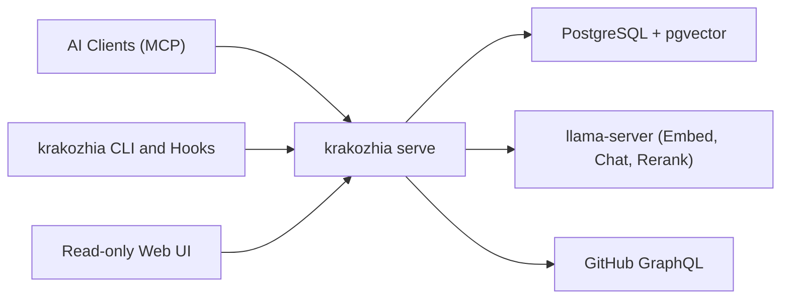

# krakozhia

[](https://github.com/rustatian/krakozhia/actions/workflows/ci.yaml)


Self-hosted knowledge base for coding agents, backed by PostgreSQL (`pgvector`) and local GPU inference (`llama-server`).

`krakozhia` stores versioned Markdown documents, Claude Code memory notes, distilled chat sessions, GitHub issues and roadmaps, project briefs, and structured benchmarks. Hybrid retrieval combines exact cosine similarity and bilingual (`english` + `simple`) full-text search with reciprocal rank fusion (`k=60`), recency decay, and supersede penalties.



## Interfaces

| Endpoint | Auth | Purpose |
| :--- | :--- | :--- |
| `/mcp` | Bearer token | Streamable HTTP MCP server for Claude Code, Antigravity, Codex, and OpenCode |
| `/api/v1/*` | Bearer token | JSON REST API for the CLI binary and hooks |
| `/`, `/roadmaps`, `/projects/{project}` | Read-only | HTML browser for projects, roadmaps, documents, notes, search, and benchmarks |
| `/healthz`, `/metrics` | None | Health probes and Prometheus metrics |

## Quick Start

Install the CLI binary into `~/.local/bin`:

```sh
GOBIN=$HOME/.local/bin go install .
```

Create `~/.config/krakozhia/config.json` with mode `0600` (or set `KRAKOZHIA_API_TOKEN` in your environment):

```json
{
  "url": "https://kb.lab.rustatian.me",
  "token": "<bearer-token>",
  "max_distance": 0.42,
  "min_text_score": 0.75,
  "max_pointers": 3,
  "source_agent": "claude"
}
```

Install the Claude Code plugin from this repository to enable automatic `recall` on `UserPromptSubmit`, async `sync` on `Stop`, and the `memory-search` and `save-document` skills.

## CLI Reference

| Command | Purpose |
| :--- | :--- |
| `krakozhia serve` | Run the HTTP API, MCP server, web UI, GPU enrichment workers, and GitHub syncer |
| `krakozhia search [--project P] [--kind note\|doc\|github] [--type T] [--tag G] [-k N] [--rerank] <query>` | Run hybrid search and print matching pointers with snippets |
| `krakozhia save --name N --type <spec\|plan\|report\|guide\|decision> [--project P] <file>` | Secret-scan and upload a Markdown document revision |
| `krakozhia show [--revision N] [--note] <id>` | Print a document, section (`<id>#<index>`), or memory note |
| `krakozhia list [--project P] [--type T] [-k N]` | List stored documents |
| `krakozhia brief <project>` | Print the synthesized Markdown brief for a project |
| `krakozhia bench <record\|query\|compare> ...` | Record, filter, or compare structured numeric benchmarks |
| `krakozhia sync` | Sync `~/.claude/projects/*/memory/*.md` notes to the server |
| `krakozhia sync-chats [--since 30d] [--all] [--agent claude\|antigravity\|codex\|opencode] [--dry-run]` | Redact and ingest finished chat transcripts for async GPU distillation |
| `krakozhia sync-github` | Trigger an immediate GitHub roadmap sync pass |
| `krakozhia recall` | Claude Code `UserPromptSubmit` hook that prints up to 3 gated pointers |
| `krakozhia eval [--rerank] [--kind note\|doc\|github\|""] <testset.jsonl>` | Measure recall@K, MRR, false-injection rate, and latency across search forms |

<details>
<summary><strong>Server environment variables (<code>krakozhia serve</code>)</strong></summary>

| Variable | Default | Purpose |
| :--- | :--- | :--- |
| `KRAKOZHIA_DB_DSN` | required | PostgreSQL connection string |
| `KRAKOZHIA_API_TOKEN` | required | Bearer token for `/mcp` and `/api/v1/*` |
| `KRAKOZHIA_LISTEN` | `:8080` | HTTP listen address |
| `KRAKOZHIA_INFERENCE_URL` | `http://llama-server.inference.svc.cluster.local:8080` | `llama-server` base URL |
| `KRAKOZHIA_INFERENCE_TIMEOUT` | `180s` | HTTP timeout for inference requests |
| `KRAKOZHIA_EMBED_MODEL` | `qwen3-embedding-0.6b` | Embedding model name |
| `KRAKOZHIA_CHAT_MODEL` | `gemma-4-12b-it` | Chat model for distillation, roadmaps, and briefs |
| `KRAKOZHIA_RERANK_MODEL` | `bge-reranker-v2-m3` | Optional cross-encoder rerank model |
| `KRAKOZHIA_ENRICH_WORKERS` | `1` | Background GPU enrichment worker count |
| `KRAKOZHIA_GITHUB_OWNERS` | empty | Comma-separated GitHub orgs or users to sync with org roadmaps |
| `KRAKOZHIA_GITHUB_REPOS` | empty | Comma-separated standalone `owner/repo` entries to sync without org roadmaps |
| `KRAKOZHIA_GITHUB_TOKEN` | empty | Default GitHub read-only token |
| `KRAKOZHIA_GITHUB_TOKENS` | empty | Per-owner `owner=token` overrides |
| `KRAKOZHIA_GITHUB_SYNC_INTERVAL` | `2h` | GitHub polling interval |
| `KRAKOZHIA_GITHUB_CLOSED_LOOKBACK_DAYS` | `90` | Days of closed issues and PRs to retain |

</details>

## MCP Client Setup

<details open>
<summary><strong>Claude Code</strong></summary>

```sh
claude mcp add --transport http --scope user krakozhia https://kb.lab.rustatian.me/mcp \
  --header "Authorization: Bearer ${KRAKOZHIA_API_TOKEN}"
```

</details>

<details>
<summary><strong>Antigravity / Gemini (<code>mcp_config.json</code>)</strong></summary>

```json
{
  "mcpServers": {
    "krakozhia": {
      "serverUrl": "https://kb.lab.rustatian.me/mcp",
      "headers": {
        "Authorization": "Bearer ${KRAKOZHIA_API_TOKEN}"
      }
    }
  }
}
```

</details>

<details>
<summary><strong>Codex (<code>~/.codex/config.toml</code>)</strong></summary>

```toml
[mcp_servers.krakozhia]
url = "https://kb.lab.rustatian.me/mcp"
bearer_token_env_var = "KRAKOZHIA_API_TOKEN"
```

</details>

<details>
<summary><strong>OpenCode (<code>opencode.json</code>)</strong></summary>

```json
{
  "mcp": {
    "krakozhia": {
      "type": "remote",
      "url": "https://kb.lab.rustatian.me/mcp",
      "headers": {
        "Authorization": "Bearer {env:KRAKOZHIA_API_TOKEN}"
      }
    }
  }
}
```

</details>
